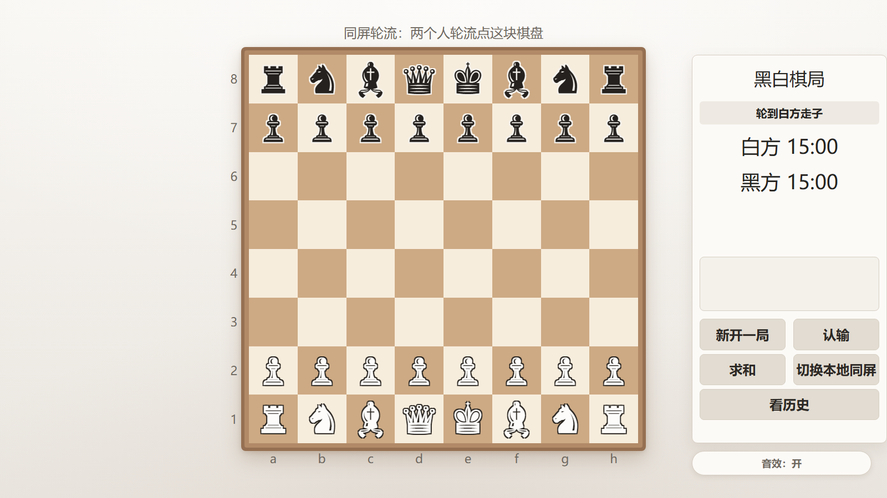

# 黑白棋局 · 千星奇域 2D 国际象棋

> 用「千星奇域 / 千星沙箱」的**客户端控件 + 客户端 Lua 脚本**做的一套纯 2D 双人国际象棋。
> 没有 3D 场景、没有模型、没有贴图 —— 棋盘、棋子、面板、弹窗全部由脚本**逐控件画出来**。
>
> 附带一个**离线单文件网页 Demo**（`proto/chess_demo.html`，双击即玩），用来在装进游戏之前先看效果。

<p align="center">
  
</p>

> 截图来自 `proto/chess_demo.html`（离线网页 Demo）。它与 Lua 脚本共用同一套**配色、布局尺寸与文案**；
> **区别是 Demo 的棋子用 Unicode 棋符绘制，而游戏内的棋子由 74 个拟合图元拼合而成**（见上文「亮点」）。
> 游戏内画面外面还会套一层容器/窗口边框。

**一句话**：在一套不提供自定义贴图、不提供现成动画的 UGC 平台里，只用基础图元和自绘缓动，
从零画出一盘规则完整、能联机、能复盘的国际象棋。

---

## 满足的约束（这个项目为什么要绕路）

千星奇域的客户端 UI 是一个**能力边界相当窄**的运行时。项目里几乎所有「奇怪」的设计，
都是被下面这几条约束逼出来的 —— 先看这个，后文会好读很多：

| 平台约束 | 本项目的应对 |
|---|---|
| 图片控件**只能引用官方预设白名单**，无法上传自定义 PNG | 棋子不贴图，改为「算法拟合 + 基础图元拼合」，见下文 |
| 基础图元只有矩形 / 椭圆 / 三角形三种 | 用集合覆盖算法把 cburnett 棋子剪影拟合成这三种形状的并集（IoU 0.9835~0.9980） |
| 没有现成的帧动画 / 序列帧 | 自建缓动函数组 + 任务调度器，逐帧重绘 |
| `game.Tween` 只能补间**单个控件** | 不用它 —— 一枚棋子是几十个控件，分别补间会散架。见下文「亮点」 |
| 没有 DOM、没有 CSS、没有图层混合 | 手写 z 序、手写「镂空」（用底色再画一遍同一形状） |
| 没有 `require` 之外的外部资源加载 | 单文件自包含，零第三方运行时依赖 |
| 音效只能按资产 ID 播放 | `game.PlayAudio2D(id)`，不附带音频文件 |

## 玩法与操作

**双人国际象棋，轮流操作同一块棋盘。**

| 操作 | 做法 |
|---|---|
| 选子 | 点一枚**轮到你**走的棋子 → 该格亮起琥珀色框，所有合法落点显示为绿点 |
| 走子 | 再点亮的绿点。点空白处取消选择 |
| 吃子 | 直接点敌方棋子所在的绿点；被吃的子缩小淡出 |
| 特殊走法 | 王车易位 / 吃过路兵 / 升变（弹窗选择后兵车马象）/ 将死 / 逼和 / 三次重复 / 五十步 / 子力不足，全部实现 |
| 面板按钮 | 新开一局 · 认输 · 求和 · 切换本地同屏 |
| 复盘 | 终局后点「复盘」，可逐手回放；所有渲染读快照，不改对局状态 |
| 棋钟 | 双方各 15 分钟，每走一步加 10 秒；跌破 30 秒变红 |

**提示条会告诉你现在该干什么**（"点一枚自己的棋子，再点亮起来的格子" / "已选中 · 点亮的格子都能走" /
"轮到你走了" / "等对方走子"）。非法落点会被拒绝并且**不会打断选中状态**。

## 亮点

- **棋子是纯代码画的。** 千星奇域的图片控件只能引用官方预设素材白名单，**没有上传自定义图片的入口**。
  本项目的做法是把 cburnett 象棋字型的轮廓用算法拟合成「矩形 / 椭圆 / 三角」的拼合体
  （6 枚棋子共 **74 个图元**，单枚 6~17 个，剪影 **IoU 0.9835~0.9980**），
  再用平台的基础图元逐个染色绘制。渲染分六层（投影 / 外形描边 / 外形填充 / 镂空描边 /
  镂空填充 / 细节线）—— 棋盘上真的有一套能分清白黑的立体棋子，而不是 Unicode 字符。
- **一枚棋子 = 一槽控件，动画必须跑同一条时间线。** 平台的 `game.Tween` 是按控件对象补间的，
  而「一枚棋子」是十几到三十几个控件组成的整体，一旦分别补间就会在动画中途散架。
  所以脚本里自带一套缓动 + 任务调度（第 5.5 区 `ANIM`），一条时间线重画整枚棋子。
- **规则引擎经过 perft 验证。** `RULES` 区与 python-chess 标准答案在 6 个标准局面 × 深度 1–3
  上逐节点一致（initial d3 = 8902、kiwipete d3 = 97862 …），特殊走法全部覆盖。
- **复盘是逐手回放**，不是重新开一局：每走一步存一份最小快照（FEN + 文案 + 起终点 + 失子数 +
  双方棋钟），复盘中所有渲染都读快照，**绝不改对局状态**。
- **能力探测 + 降级**贯穿全脚本：平台的每个接口都先探测再用，沙箱里没有的能力
  （信号参数、光标坐标、音效等）自动降级而不是崩溃。

## 快速开始

### 一、先玩网页版（不用装任何东西）

双击 `proto/chess_demo.html`，用浏览器打开。白方先走：**点棋子 → 点亮起来的格子**。

Demo 是纯内联单文件：无外部 JS/CSS、无网络请求、离线可用。它和 Lua 脚本共用同一套规则实现、
布局尺寸与文案，用来对照效果；**但它不是交付件** —— 真机效果以 Lua 脚本为准。

### 二、装进千星奇域

看 **[`out/交付包/挂载指南.md`](out/交付包/挂载指南.md)**，跟着做即可。概括起来 6 件事：

1. 建一个「客户端控件容器」（它是**唯一**能让客户端控件显示出来的服务器控件）
2. 把 `out/交付包/levelScript.lua` 导入客户端脚本资源管理器并**新建脚本映射**
3. 建 3 个控件模板：文本框 / 光标检测区域 / 图片
4. 把这 3 个模板的**模板索引** + 容器节点索引，填进脚本开头的 `CONFIG`（交付版里它们都是 `0`）
5. 把脚本挂到容器节点上
6. 进游戏试玩

> 要填的是「**模板根节点**」的索引，不是模板内部某个子控件的索引 —— 这是最容易踩的坑，
> `挂载指南.md` 里有详细说明。
>
> ⚠️ **`paint_slot` 依赖图片控件**：`PREFAB_IMAGE` 是 `CONFIG` 里唯一「不填就完全没棋子」的项。
> 忘了填的表现是「棋盘格子都在、但盘面上空的」。

**联机需要对端配合**：脚本会发出 `ChessSync` 信号（走子 / 求和 / 认输 / 和棋 / 新局 等事件类型），
但**接收端要由使用者在编辑器里自己搭服务端节点图**（把信号转发到另一端的实体）。
不搭也能玩 —— 脚本检测到信号不可用时会降级为**本地同屏轮流**，面板上会出现「切换本地同屏」。
协议格式见 [`out/交付包/交付说明.md`](out/交付包/交付说明.md)。

### 音效：默认已配好，可一键开关

脚本用官方客户端脚本 API `game.PlayAudio2D(audioId)` 播放音效，`CONFIG.SFX` 里 10 项**已填好默认 ID**，
开箱就有声音。面板下方有一个**「音效：开 / 音效：关」**按钮可以随时切换。

| 键 | 音效 ID | 用途 |
|---|---|---|
| `CLICK` | `50888` | 面板按钮 |
| `SELECT` | `50894` | 选中棋子 |
| `MOVE` | `50942` | 普通走子 |
| `CASTLE` | `50879` | 王车易位（只播这条，不播 MOVE） |
| `CAPTURE` | `40186` | 吃子 |
| `CHECK` | `50937` | 将军 |
| `PROMOTE` | `50940` | 升变 |
| `GAME_END` | `50919` | 终局 |
| `LOW_TIME` | `50931` | 棋钟跌破 `SFX_LOW_TIME_SEC`（默认 30 秒），每方只播一次 |
| `RESIGN` | `50934` | 认输 |

两个配套常量：`SFX_HISTORY = 8`（记最近 8 个音效实例，用于新开一局时停掉上一局尾音）、
`SFX_LOW_TIME_SEC = 30`（告急阈值）。

**关于这些 ID 的三点说明**：

1. **音效资产由平台提供，文件不在本仓库内。** 这里只是引用平台公开资产清单里的标识符，
   音频文件既不包含也不分发（见 [音频](#音频)）。
   在不同账号/项目里能否直接复用，取决于平台的资产授权，请以编辑器「音效资产」面板实际显示为准。
2. **写 `0` 就是不播。** 把任意一项改成 `0` 即可单独静音；全改 `0` 等于无声版，**依然能正常玩**。
3. **有降级保护**：`sfx_play()` 用 `pcall` 包住调用并做一次性能力探测 ——
   平台若不提供 `PlayAudio2D`（或在静音环境返回 `nil`），脚本记录一次日志后**自动转为静音**，
   不会报错、不会刷屏、不影响对局。模拟器默认静音，所以那里听不到声音是正常现象。

## 技术栈与平台

| | |
|---|---|
| 平台 | 千星奇域（原神 UGC）· 客户端控件 + 客户端 Lua 脚本 |
| 语言 | Lua 5.3（平台运行于 fengari；`io.*` / `coroutine.*` / `string.dump` 不可用） |
| 画布 | 多端横屏，设计基准 **1600 × 900**，脚本按实际画布等比缩放 |
| 规模 | `lua/levelScript.lua` 单文件 **约 5000 行 / 211 KB**；运行时约 **1399** 个动态控件 |
| 依赖 | **无第三方运行时依赖**。不用 `require`，不用外部图片，不用自定义素材 |
| 开发脚手架 | Node.js（验证/同步脚本）、Python（perft 标准答案生成）、Playwright（Demo 截图量测） |
| 授权 | 代码 MIT；棋子素材 CC BY-SA 3.0 —— 见 [授权与第三方声明](#授权与第三方声明) |

> 关于「无依赖」的准确含义：**Lua 运行时**零依赖（单文件自包含，不 `require` 任何东西）。
> 但**仓库里的开发脚本**要用 Node.js 跑，其中 `lua_check.cjs` 需要 `luaparse`，
> 部分脚本引用了本机沙箱目录的绝对路径。详见下文「如何验证」。

## 目录结构

```
lua/
  levelScript.lua            ★ 正式交付脚本（单文件，约 5000 行；4 个模板索引为 0 待填）
  levelScript.sandbox.lua      沙箱自检变体（体外模拟器用，不进交付包）
  chess_pieces.lua             早期手绘形状表（已停用，留作对照）

sim/
  levelScript.lua            ★ 模拟器副本（= 交付脚本 + 4 个真实模板索引）
  piece_*.lua                 12 份拟合棋子数据（v1.5 史料，v1.7 起不再 require）
  probe.lua / *_probe.lua     能力/渲染/输入探针，不属于交付物

proto/
  chess_demo.html            ★ 离线网页 Demo（单文件、无网络请求）

out/
  交付包/                    ★ 给使用者的交付物（脚本 + Demo + 5 份说明文档）
  棋子素材-en-croissant/       cburnett 棋子素材原件（CC BY-SA 3.0）

docs/
  tech-architecture.md       ★ 技术架构与文件职责（改结构必须同步）
  策划案.md                    玩法/界面/文案的唯一来源（769 行）
  项目状态记录.md               跨会话状态与缺陷记录
  挂载指南/交付说明等           见 out/交付包/
  pieces-fit-report.md         棋子拟合方法与指标
  锚定配置表.md / Lua实现设计.md / 沙箱能力清单.md
  images/screenshot-pieces.png README 用截图

records/playtest.md           试玩记录（每条标注 runtime=simulator 还是真机）
tools_work/                   拟合 / 验证 / 同步 / 截图工具脚本（开发脚手架，非交付件）
workspace/chess/chess.save.json  千星 UI 模拟器存档（可直接加载回放界面结构）
```

**三份 `levelScript.lua` 的关系**（这是本项目最容易出错的地方）：

| 文件 | 模板索引 | 用途 |
|---|---|---|
| `lua/levelScript.lua` | 全 `0` | 交付版 —— 用户填自己的索引 |
| `sim/levelScript.lua` | 4 个真实值 | 模拟器试玩用 |
| `out/交付包/levelScript.lua` | 全 `0` | 发布快照 —— 用户实际拿去挂载的文件 |

三者**除 CONFIG 的 4 个模板索引与头部注释外代码必须逐字相同**。
改一份就要同步另外两份，否则会出现「模拟器能跑、交付给用户的跑不了」。
别手工对比，用脚本：

```bash
node tools_work/sync_sim_copy.cjs      # lua/ → sim/
node tools_work/sync_delivery.cjs      # lua/ → out/交付包/
```

## 如何验证

仓库带了一套可复现的验证脚本（`tools_work/`）。按「要不要装东西」分三档：

### 一档：纯 Node.js，装一个包就能跑

```bash
# 静态检查：Lua 5.3 语法 + 11 个分区顺序 + 局部函数先声明后使用 + 未定义全局
cd tools_work/tmp/jscheck && npm i luaparse
cd ../../.. && node tools_work/lua_check.cjs
```

`lua_check.cjs` 默认检查 `lua/` `sim/` 和 `out/交付包/` 三份文件，能抓出本项目最容易犯的两类错：
分区顺序错乱、以及 `local function` 在定义前被调用（曾导致启动直接崩）。

```bash
node tools_work/consistency_check.cjs   # Demo 与 Lua 的文案/配色/字号/尺寸逐项核对
```

### 二档：需要 Lua VM（fengari）

```bash
node tools_work/rules_test.cjs          # 对正式 Lua 抽 RULES 区跑 perft + 特殊规则 + 棋钟公式
node tools_work/play_test.cjs           # 沙箱里模拟点 e2→e4，断言走子生效、非法落点被拒、fuzz 不炸
```

这两个脚本引用本机沙箱目录常量 `SANDBOX_DIR`（在文件头部），**换机器要先改那一行**。

### 三档：需要浏览器（Playwright / Edge）

```bash
node tools_work/verify_demo.mjs         # 真实浏览器打开 Demo，取回页面内自检结果
node tools_work/measure_demo.mjs        # 多分辨率量测（PC 16:9 / 21:9、手机 16:9 / 19.5:9 / 4:3）
```

### 想直接看证据

`records/playtest.md` 逐条记录了试玩结果，**每条都标注了 `runtime=`**。
`reports/` 里是过程截图与日志（大部分被 `.gitignore` 排除，只留 `delivered_sbx.json`、
`perft_d3.log`、`sbx_run.json` 这三份文本证据入库）。

> **模拟器绿灯 ≠ 真机通过。** 体外沙箱只记录 API 调用，不检查文本是否排得进控件框、
> 不看控件数量是否超容量、不跑真实渲染。本项目已经有多处「沙箱/模拟器通过、真机行为未验证」的项，
> 见下文「已知限制」。

## 验证过什么

以下是**实际跑出来的结果**，不是设计意图。证据在 `records/playtest.md` 与 `docs/项目状态记录.md`。

**规则正确性**

- perft 交叉验证：6 个标准局面 × 深度 1–3，与 python-chess 逐节点一致
  （initial d3 = 8902、kiwipete d3 = 97862 …）。
- 特殊走法逐例验证：王车易位 / 吃过路兵 / 升变 / 将死 / 逼和 / 五十步 / 三次重复 / 子力不足。

**性能（v1.10 优化，runtime=simulator 实测）**

- **动画期间每帧控件写 320 → 72（约 -78%）**。`render_pieces(onlySlots, onlyCount)` 加了快速路径，
  动画期间只重绘真正变动过的槽位，跳过 `bySq` 重建与整盘遍历；
  实测 `full=10 partial=0` → `full=2 partial=8 slots=8`，稳态每帧重绘 32 槽 → **1 槽**。
- 动画结束后的补帧逻辑保持不变，所以不会残留半格。

**界面与音效（v1.10，runtime=simulator 实测）**

- 浅色主题已落地：暖米外壳 + 深字 + 琥珀强调色，24 条背景带相邻最大通道差 ≤ 1（连续无横线）。
- **10 组音效实跑触发成功**，实测触发到的有：`SELECT 50894`（点 e2）、`MOVE 50942`（走 e4）、
  `CLICK 50888`（面板按钮）、`RESIGN 50934`（认输）、`GAME_END 50919`（终局）。
  其余 5 组（`CASTLE` / `CAPTURE` / `CHECK` / `PROMOTE` / `LOW_TIME`）代码路径已就位但未逐项触发，
  见「已知限制」。
- 走子链路完整：点 e2→e4 生效，走子记录「白 e2→e4」，轮次切换，棋钟加秒，
  服务端收到 `ChessSync [0,12,28,0,""]` 并广播 `sent ChessSync to AllPlayers`。
- 音效开关生效：关闭后点棋盘不再产生音效实例，重新打开后恢复。

**静态与一致性**

- `lua_check.cjs`：Lua 5.3 语法、11 个分区顺序、局部函数先声明后使用、未定义全局 —— 三份脚本全过。
- `consistency_check.cjs`：Demo 与 Lua 的文案、配色、字号、尺寸逐项核对。
  注意它只比对**配色/字号/文案/尺寸**，**不含棋子画法**（Demo 用 Unicode 棋符，见上方图片说明）。

> ⚠️ **以上全部是模拟器 / 体外沙箱结果。** 真机运行仍未验证，见下节。

## 已知限制

**关于平台能力的**

- 图片控件不能上传自定义图，所以棋子只能是「图元拼合」；想更精细要等平台开放素材上传。
- 图元只有矩形 / 椭圆 / 三角形，所以 cburnett 的曲线细节（马的鬃毛、王的冠带）只能用近似拟合，
  放大看会有直线段感（实测分布：椭圆 47 / 矩形 20 / 三角 7）。当前 74 个图元**全部是外形剪影**，
  分层渲染里的「镂空」与「细节线」两层代码已经就位，但没有图元使用它们 —— 细节线留作后续增强。
- `CONFIG.PIECE_PRIM_BUDGET`（默认 64）只是**上限**，实际分配数由 `PIECE_ART` 里最多的那枚决定
  （当前 17），启动时用 `piece_prim_max()` 校正后才建槽位。所以它现在**不起作用**，
  调小到 17 以下会截断棋子形状（缺零件），不是「省控件」的旋钮。
- 基础图元没有图层混合 / 挖洞能力，「镂空」是靠**用棋盘底色再画一遍同一形状**模拟的。
  这要求镂空形状必须落在一个纯色格子里，跨格镂空会露馅。

**关于联机的**

- `ChessSync` 信号的接收侧**不在本仓库内**：需要使用者自己在编辑器里搭服务端节点图转发。
  不搭就是本地同屏。
- 部分环境下信号参数不可用，脚本做能力探测后自动降级。

**关于真机（未验证部分）**

- **真机运行未经确认**。所有结果来自千星 UI 模拟器（Lua Runtime + fengari）与体外沙箱，
  没有在编辑器里真机跑过。
- **真机控件容量未验证**：运行时约 **1399** 个控件。若真机超上限，**能真正省控件的旋钮只有
  `CONFIG.PIECE_MAX_SLOTS`（32，总槽位数）** —— 但盘面同时最多需要 32 枚棋子，
  调小会导致部分棋子画不出来。想少控件只能改 `PIECE_ART` 减少图元数（用精度换容量）。
- **只跑过 2 个画布**：`pc-16-9`(1600×900) 与 `mobile-16-9`(1280×720)。
  `pc-21-9`、`mobile-19.5-9`、`mobile-4-3` 未实测，布局按等比缩放理论推导。
- **动画中途帧未逐帧验证**：走子抛物线抬升、落子回弹、开局弹入、吃子淡出、弹窗淡入
  都只看了终态截图，没有逐帧抓中间形态。
- **音效一个都没在真机听过**：模拟器默认静音，`game.PlayAudio2D` 的调用路径只做了静态检查。
- **面板按钮未逐一点验**：只有棋子样式切换按钮在模拟器里实际点过；
  新开一局 / 认输 / 求和 / 同屏 的逻辑路径已通，交互未逐个验收。
- 其余细节见 `records/playtest.md` 各节末尾的「本轮未验证项」。

## 授权与第三方声明

**代码以 MIT 发布**，见 [`LICENSE`](LICENSE)。

本仓库采用**按部分授权**，不同目录适用不同许可证 —— 完整说明见 [`NOTICE`](NOTICE)：

| 部分 | 授权 |
|---|---|
| 游戏代码、文档、界面设计（`lua/` `sim/` `proto/` `tools_work/` `docs/` `out/交付包/`） | **MIT** |
| `out/棋子素材-en-croissant/` 下的 cburnett 素材原件（SVG / PNG / CSS / JSON） | **CC BY-SA 3.0** |
| 由该素材拟合出的棋子几何数据（`PIECE_ART` 表、`docs/pieces-fit-generated.*`） | **CC BY-SA 3.0** |

### 棋子素材署名

> **cburnett** 国际象棋字型 —— 作者 **Colin M.L. Burnett**，以
> [CC BY-SA 3.0](https://creativecommons.org/licenses/by-sa/3.0/) 授权。
> 原始来源：[Wikimedia Commons](https://commons.wikimedia.org/wiki/Category:SVG_chess_pieces)；
> 经开源国际象棋 GUI 项目 [en-croissant](https://github.com/franciscoBSalgueiro/en-croissant) 提取。

**ShareAlike 的影响要说清楚**：CC BY-SA 3.0 要求演绎作品**以相同方式共享**。
所以上面表格里标为 CC BY-SA 的部分**不能按 MIT 再授权** ——
如果你要拿走这些素材或拟合数据对外发布，得保留署名并沿用 CC BY-SA 3.0。
游戏逻辑代码本身是 MIT，不受此约束。**商用前请自行复核条款**（`NOTICE` 有更详细的说明）。

**运行时脚本里不含任何图片**：棋子是按拟合坐标用平台图元重绘的，所以
只取用 `lua/levelScript.lua` 的代码部分、不取拟合数据时，授权负担会小很多。

### 音频

**本仓库不含任何游戏音频文件。** 音效以**资产 ID** 引用（`game.PlayAudio2D(id)`），
音频文件既不包含也不分发。「原神」「千星奇域」「千星沙箱」及相关名称、界面、图标、
音乐与音效资产版权归**米哈游 / HoYoverse** 所有。本项目是非官方玩家创作，与米哈游无隶属关系，
也未获得其背书。

## 致谢

- [cburnett](https://commons.wikimedia.org/wiki/Category:SVG_chess_pieces) —— Colin M.L. Burnett，
  棋子造型的来源。
- [en-croissant](https://github.com/franciscoBSalgueiro/en-croissant) —— 提供了整理好的 cburnett 素材包。
- [python-chess](https://github.com/niklasf/python-chess) —— perft 标准答案的生成器。
- [fengari](https://github.com/fengari-lua/fengari) —— 让 Lua 能在 Node.js 里跑，才有了体外沙箱验证；
  [luaparse](https://github.com/fstirlitz/luaparse) —— Lua 语法静态检查。
- 千星沙箱官方文档 —— 客户端控件与 Lua 脚本接口的依据来源。

---

<sub>非官方玩家创作项目。原神 / 千星奇域版权归米哈游所有。</sub>
